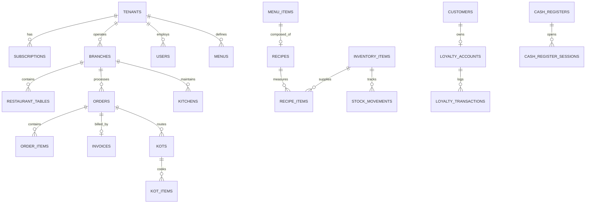

# Database Architecture & Schema Specification

## 1. Overview
The platform database is modeled in PostgreSQL using normalized 3NF structures with UUID primary keys and defense-in-depth Row-Level Security (RLS). Decimal numeric types are enforced for all monetary values (`Numeric(10,2)`) to eliminate floating-point rounding errors.

---

## 2. Entity Groups & Relationships

---

## 3. Core Tables Specification

### `tenants`
- `id`: String(36) UUID PK
- `name`: String(255)
- `slug`: String(100) UNIQUE
- `status`: String(50) (Active, Trial, Suspended, Deactivated)
- `currency`: String(10) (INR, USD, EUR, GBP)
- `timezone`: String(50)
- `onboarding_completed`: Boolean

### `orders`
- `id`: String(36) UUID PK
- `tenant_id`: String(36) FK (tenants.id)
- `branch_id`: String(36) FK (branches.id)
- `order_number`: String(50) (e.g. `ORD-261030-0001`)
- `order_type`: String(30) (DineIn, Takeaway, Delivery, Online, QR)
- `subtotal`: Numeric(10, 2)
- `discount_amount`: Numeric(10, 2)
- `tax_amount`: Numeric(10, 2)
- `service_charge`: Numeric(10, 2)
- `total_amount`: Numeric(10, 2)
- `status`: String(30) (Draft, Confirmed, InKitchen, Ready, Served, Completed, Cancelled)

### `order_items`
- `id`: String(36) UUID PK
- `order_id`: String(36) FK (orders.id)
- `menu_item_id`: String(36)
- `item_name`: String(255) (Snapshot)
- `unit_price`: Numeric(10, 2) (Immutable price snapshot)
- `cost_price`: Numeric(10, 2) (COGS snapshot)
- `quantity`: Integer
- `subtotal`: Numeric(10, 2)
- `modifiers`: JSON

### `recipes` & `recipe_items`
- `menu_item_id`: Links recipe to menu dish
- `yield_portions`: Portion multiplier
- `recipe_items.inventory_item_id`: Raw ingredient
- `recipe_items.quantity`: Quantity consumed per portion

### `cash_register_sessions`
- `opening_float`: Numeric(10, 2)
- `cash_sales`: Numeric(10, 2)
- `cash_in`: Numeric(10, 2)
- `cash_out`: Numeric(10, 2)
- `cash_refunds`: Numeric(10, 2)
- `expected_closing_cash`: Calculated formula
- `actual_closing_cash`: Counted physical cash
- `variance`: actual - expected
