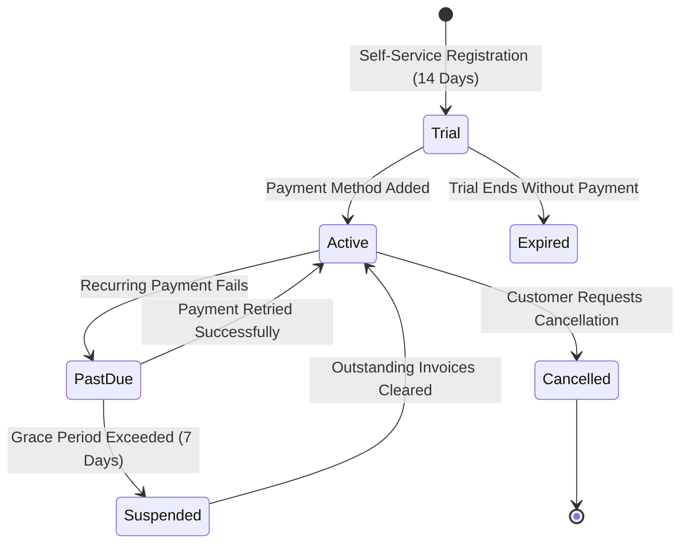

# Subscription Lifecycle & SaaS Billing

## 1. Subscription Tiers & Feature Matrix

| Plan Tier | Monthly | Annual | Max Branches | Max Users | Max POS | Key Feature Entitlements |
|---|---|---|---|---|---|---|
| **Starter** | $49 | $490 | 1 | 5 | 2 | POS, Menu, Tables, Invoicing, Basic Reports |
| **Growth** | $99 | $990 | 3 | 15 | 6 | Starter + Kitchen KDS, Raw Materials Inventory, CRM |
| **Professional** | $199 | $1990 | 10 | 40 | 15 | Growth + Recipe BOM, Loyalty Ledger, QR Table Ordering, Delivery |
| **Enterprise** | $399 | $3990 | 100 | 500 | 100 | All features + Multi-branch consolidated reports, API Access |

---

## 2. Subscription Lifecycle States



---

## 3. Entitlement Guardrails

Feature entitlements are enforced at the backend dependency level. When an organization attempts to add a branch beyond their plan entitlement, the backend rejects the request:
```python
if current_branches >= subscription.plan.branch_limit:
    raise HTTPException(status_code=403, detail="Branch limit reached for current plan.")
```
